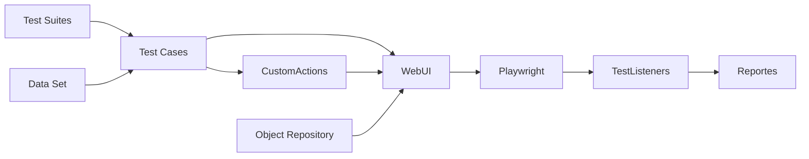

# POC Playwright · Farmacias Similares

Framework en **TypeScript + Playwright Test** con organización y pasos inspirados en Katalon Studio. El recorrido termina en los campos de tarjeta: no captura tarjetas ni ejecuta `Comprar ahora`.

## Inicio rápido

Requisitos: Node.js 20 o superior y pnpm. Desde la raíz:

```powershell
pnpm install --frozen-lockfile
pnpm install:browsers
if (-not (Test-Path .env)) { Copy-Item .env.example .env }
# Completar los datos autorizados de contacto en .env
pnpm typecheck
pnpm test
pnpm report
```

También se pueden ejecutar los scripts con npm después de instalar las dependencias. Este repositorio versiona `pnpm-lock.yaml`; para instalaciones reproducibles se recomienda pnpm.

El `.env` local de esta POC ya contiene el contacto autorizado en la conversación. Se excluye de Git. `.env.example` documenta los campos sin exponer el correo ni teléfono. El envío utiliza una calle ficticia, número exterior `1`, colonia Los Almendros y CP `45133`.

## Estructura y responsabilidades

```text
Test Cases/          Casos independientes con pasos y validaciones
Test Suites/         Catálogo de suites y sus etiquetas
Data Set/            Datos del catálogo en JSON; contacto/envío desde .env
Object Repository/   Objetos y localizadores centralizados
CustomActions/       Flujos reutilizables: tienda, contacto, envío y pago
Core/                Fachada WebUI
TestListeners/       Fixtures antes/después y reporter de ejecución
Reportes/            HTML, JSON, JUnit y evidencias generadas
playwright.config.ts Navegador, tiempos, concurrencia y reportes
```

Los localizadores reciben la página de cada prueba. No hay página global, dependencia de orden entre casos ni una sesión compartida. Se ejecuta con un worker para reducir la carga sobre el sitio real.



Cada flujo E2E tiene su propio archivo `TC01` a `TC05`; `framework.spec.ts` reúne las comprobaciones técnicas locales.

## Escenarios

| Caso | Objetivo y criterio de éxito | Suite |
| --- | --- | --- |
| TC01 · Seleccionar ubicación | Inicio → método de entrega → colonia del CP 45133 → confirmar → ubicación seleccionada en encabezado | smoke, regression |
| TC02 · Buscar producto | Inicio → ubicación → buscar algodón → detalle con nombre, descripción y URL correctos | smoke, regression |
| TC03 · Agregar producto al carrito | Inicio → buscar → detalle → seleccionar entrega CP 45133 → agregar → carrito con producto y cantidad 1 | smoke, regression |
| TC04 · Comprar producto | Inicio → buscar → detalle → entrega CP 45133 → carrito → contacto → términos autorizados → envío → mapa → formulario de tarjeta habilitado y vacío | checkout |
| TC05 · Vaciar carrito | Inicio → buscar → detalle → entrega CP 45133 → agregar → aumentar cantidad a 2 → eliminar → carrito vacío incluso después de recargar | regression |

`framework` comprueba localmente la fachada y las guardias de carrito vacío, cantidades y disponibilidad. No depende de la tienda ni cuenta como escenario de negocio.

## Ejecución

```powershell
pnpm test:smoke
pnpm test:e2e
pnpm test:regression
pnpm test:checkout
pnpm test:framework
pnpm test:headed
pnpm test:ui
pnpm exec playwright test --project=regression --grep TC05
```

`pnpm test:e2e` ejecuta los cinco flujos de negocio. `pnpm test` agrega las comprobaciones locales del framework, sin duplicar las otras suites. Cada ejecución regenera los reportes de ese comando.

## Precondiciones y avisos

Cada flujo prepara su propia sesión y sus productos; no requiere ejecutar otro caso antes. Antes de continuar a compra se valida que el carrito tenga productos, cantidades mayores que cero y el botón de continuar habilitado.

Si el carrito está vacío, se detiene con el aviso **`[PRECONDICION:EMPTY_CART] Carrito vacío: no se puede continuar con la compra. Agrega al menos un producto y vuelve a ejecutar el flujo.`**

También existen avisos para `INVALID_QUANTITY`, `MISSING_DATA`, `INVALID_EMAIL`, `INVALID_PHONE`, `OUT_OF_STOCK` y `NO_COVERAGE`. Los mensajes aparecen en consola y en el reporte HTML, con una anotación `precondicion`. El JSON los clasifica como `outcome: blocked`. Playwright y JUnit registran la ejecución como fallida para que un pipeline no los interprete como aprobados.

Un botón que no carga o un checkout que no responde sigue siendo un fallo funcional; no se transforma automáticamente en falta de stock o carrito vacío. Las esperas consultan el estado de la UI y los avisos de precondición solo se generan cuando hay evidencia concreta. Las recomendaciones agotadas no bloquean la disponibilidad del producto principal.

## Escribir pasos al estilo Katalon

```typescript
import { test } from '../TestListeners/fixtures';
import { Product } from '../Object Repository/objects';
import data from '../Data Set/tienda.json';

test('Nuevo caso @regression', async ({ WebUI }) => {
  await WebUI.navigateToUrl(data.producto.ruta);
  await WebUI.verifyElementVisible(Product.title(data.producto.nombre));
  await WebUI.click(Product.add);
  await WebUI.verifyElementVisible(Product.added);
});
```

La sintaxis es `WebUI.accion(objeto, parametros)`. Las acciones existentes incluyen `click`, `setText`, `typeText`, `pressKey`, `selectOption`, `setChecked`, `verifyElementVisible`, `verifyElementEnabled`, `verifyValue` y `verifyUrl`. Cada llamada genera un step legible en el reporte.

`setText` usa `fill`; `typeText` escribe con eventos de teclado y Tab. El checkout VTEX actualiza varios campos con `afterkeydown`, por eso contacto y envío utilizan `typeText`. La acción comprueba el valor y repite la captura hasta tres veces si un render intermedio lo truncó; un error de interacción o un valor que no se conserva sigue fallando.

## Agregar o mantener funcionalidades

1. Agregar datos reutilizables a `Data Set/`, manteniendo los datos privados en `.env`.
2. Declarar el objeto con `object('Pantalla / Elemento', page => page.getByRole(...))` en el repositorio. Preferir rol, etiqueta o ID estable. Los selectores de componentes del proveedor se concentran ahí para facilitar cambios.
3. Agregar acciones simples a `Core/WebUI.ts`; un recorrido de negocio compuesto pertenece a `CustomActions/`.
4. Crear el caso en `Test Cases/` e importar `test` de `TestListeners/fixtures` para obtener la fachada y las evidencias.
5. Asignar `@smoke`, `@regression` o `@checkout`; una nueva suite se configura en `Test Suites/catalog.ts` sin copiar casos.

Para agregar Firefox o WebKit, instalar su navegador y crear un proyecto con `use.browserName`. Chromium es el navegador validado para esta POC.

## Listeners y reportes

- Playwright crea un contexto aislado antes de cada prueba y lo destruye al terminar.
- El fixture automático adjunta captura final también en éxito. En fallo conserva captura, video y traza con pasos, DOM y red.
- `ExecutionReporter` genera `Reportes/json/execution.json` con estado, duración, reintentos y errores.
- `Reportes/html/index.html` muestra casos, pasos y adjuntos; abrirlo mediante `pnpm report`.
- `Reportes/junit/results.xml` permite integrar los resultados en un pipeline.

Las evidencias pueden contener los datos de contacto capturados. Toda la carpeta generada se excluye de Git. Para conservar una ejecución, copiar `Reportes/` antes de iniciar otra.

## Particularidades del sitio

- Cookies y promoción de inicio aparecen de forma asíncrona. Se cierran con `addLocatorHandler` mediante la UI, sin esperas fijas.
- El stock, los precios y la cobertura son dinámicos. Los casos no fijan un precio; el producto debe estar disponible en la zona al ejecutar.
- El checkout puede mostrar recomendaciones antes de contacto.
- Confirmar el mapa puede cambiar el CP y vaciar calle/número; el flujo vuelve a completar y validar el envío para conservar el CP solicitado.
- Los datos de tarjeta están en un iframe de VTEX. Los objetos usan `frameLocator`; el criterio de éxito comprueba los cinco campos, sin rellenarlos.
- La autorización para aceptar términos se otorgó para esta POC. No se crean cuentas ni pedidos.

## Referencias

[Fixtures e aislamiento](https://playwright.dev/docs/test-fixtures), [proyectos](https://playwright.dev/docs/test-projects) y [reporters](https://playwright.dev/docs/test-reporters) de Playwright.

## Validación de la POC · 27 de octubre de 2026

`pnpm typecheck` terminó correctamente. La ejecución completa `pnpm test` aprobó **11 de 11 pruebas**: los cinco flujos E2E y seis comprobaciones técnicas, sin reintentos. TC04 llegó al formulario de crédito y verificó número, titular, mes, año y código de seguridad habilitados; los datos de tarjeta permanecieron vacíos y no se confirmó ningún pedido.

El reporte de esa ejecución está en `Reportes/html/`, con capturas por caso y resultados JSON/JUnit. El reporte se renueva al ejecutar otra suite. Las comprobaciones técnicas de carrito vacío y cantidad cero provocan avisos esperados y verifican que se detenga el avance; sus pruebas están aprobadas porque ese es el comportamiento requerido.

El mapa se valida contra el CP buscado antes de confirmar: puede mostrar inicialmente una dirección predeterminada diferente. El envío comprueba el conjunto de campos después de las actualizaciones de la tienda y verifica calle, número exterior y CP también en el resumen final. Los objetos de pago apuntan al iframe específico de crédito para evitar confundirlo con débito.
